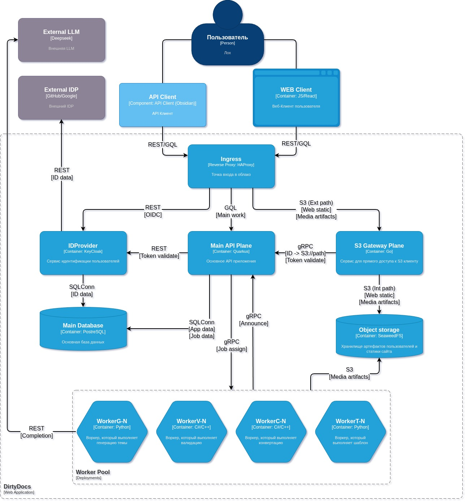
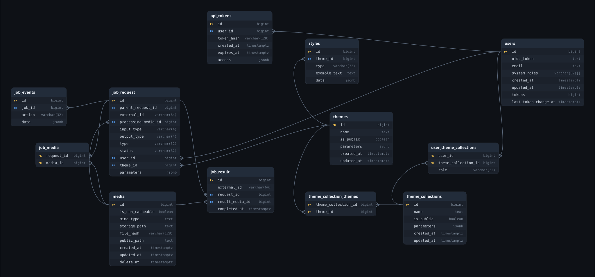

# Архитектура: C4-контекст, ERD и схема БД

Страница раздела [«Дизайн и проектирование»](README.md). Описывает архитектуру DocsApp.
**Источник правды по архитектуре — C4-диаграмма контекста ([`context.drawio`](context.drawio)) в её
текущем виде.** Остальные артефакты раздела — ERD и `db.sql` — сверяются с ней; всё, что расходитсяс C4, перечислено в разделе [«Соответствие артефактов C4»](#соответствие-артефактов-c4) и считается
отклонением, которое нужно устранить или явно согласовать.

Продуктовый baseline (возможности, ограничения, требования безопасности и хранения) — в[`.agents/PROJECT.md`](https://github.com/DirtyDocsTeam/DocsApp/blob/main/.agents/PROJECT.md)

## Исходные материалы

| Документ | Что внутри |
|---|---|
| [Требования к DocsApp (ТЗ)](https://docs.google.com/document/d/1Rr7OrQQ02rvek1e5tRGGYHzwbFi87ES4Tsxxi-tvHNA/edit) | глоссарий (стиль, конвертер), цели и бизнес-задачи, роли пользователей, функциональные требования и сценарии конвертаций, структура и экраны, интеграции, нефункциональные требования (p95/p99, SLA 99%, лимиты 10 МБ / 150 МБ / 100 запросов в минуту, 152-ФЗ, хранение результатов 3 ч и вложений 7 дней), метрики и критерии приёмки |
| [Прототип: проблема, цель, аудитория](https://docs.google.com/document/d/12z9u0MmnQihFlsePZDEoe1Tpvn0BgnE4SBqOKK5L95Y/edit) | зачем нужен продукт и чем он отличается от существующих инструментов, целевая аудитория и её задачи, как измеряется эффект, состав модулей, ограничения реализации (монолит не приемлем, обязательна AST) |

## Контекст системы (C4) — источник правды

**Участники:** «Пользователь» (автор документа) и внешние системы — **External IDP** (GitHub/Google) и **External LLM** (DeepSeek, используется только опциональным воркером генерации темы).

**Клиенты:** WEB Client (JS/React) и API Client (интеграция вида Obsidian). Оба входят через **Ingress** (HAProxy) по REST или GraphQL.

**Контейнеры внутри границы системы `DirtyDocs`:**

| Контейнер | Технология | Назначение по диаграмме |
|---|---|---|
| Ingress | HAProxy | единая точка входа, маршрутизация REST/GraphQL, внешний путь к статике и медиа |
| IDProvider | Keycloak | идентификация пользователей, федерация с внешними IDP |
| Main API Plane | Quarkus | основное API приложения: приём и оркестрация задач |
| S3 Gateway Plane | Go | контролируемый прямой доступ клиентов к объектному хранилищу |
| Main Database | PostgreSQL | пользователи, стили, задачи, результаты, аудит |
| Object storage | SeaweedFS | пользовательские медиа, сгенерированные артефакты, статика сайта |
| Worker Pool `[Deployments]` | C#/C++, Python | `WorkerC-N` конвертация, `WorkerV-N` валидация, `WorkerT-N` шаблонизация, `WorkerG-N` генерация темы |

Кто с кем разговаривает — в порядке диаграммы, сверху вниз. `—` вместо стрелки значит, что на ребре
нет наконечника: это связь, а не вызов.

<!--
  Для агентов и всех, кто читает файл, а не картинку: направление связи задаёт наконечник стрелки
  в `context.drawio`, а не порядок слов в подписи ребра. Рёбра нормализованы — наконечник
  (`endArrow=classic`) всегда у `target`, `startArrow=none`, поэтому «откуда → куда» = `source → target`;
  имя узла — атрибут `c4Name` его `<object>`. Без наконечника только два ребра (…-37, …-38 —
  Пользователь ↔ клиенты). Таблица ниже поддерживается руками и может отставать от диаграммы:
  при расхождении права C4.
-->

| Связь                             | Канал и данные                                 |
| --------------------------------- | ---------------------------------------------- |
| Пользователь — WEB Client         | —                                              |
| Пользователь — API Client         | —                                              |
| WEB Client → Ingress              | `REST/GQL`                                     |
| API Client → Ingress              | `REST/GQL`                                     |
| Ingress → IDProvider              | `REST [OIDC]`                                  |
| Ingress → Main API Plane          | `GQL [Main work]`                              |
| Ingress → S3 Gateway Plane        | `S3 (Ext path) [Web static] [Media artifacts]` |
| IDProvider → External IDP         | `REST [ID data]`                               |
| IDProvider → Main Database        | `SQLConn [ID data]`                            |
| Main API Plane → IDProvider       | `REST [Token validate]`                        |
| Main API Plane → Main Database    | `SQLConn [App data] [Job data]`                |
| Main API Plane → Worker Pool      | `gRPC [Job assign]`                            |
| S3 Gateway Plane → Main API Plane | `gRPC [ID -> S3://path] [Token validate]`      |
| S3 Gateway Plane → Object storage | `S3 (Int path) [Web static] [Media artifacts]` |
| Worker Pool → Main API Plane      | `gRPC [Announce]`                              |
| Worker Pool → Object storage      | `S3 [Media artifacts]`                         |
| WorkerG-N → External LLM          | `REST [Completion]`                            |

## Соответствие артефактов C4

C4-диаграмма — источник правды; ниже — где остальные артефакты говорят иначе и что с этим делать. Baseline (`.agents/PROJECT.md`) приведён к диаграмме: брокера сообщений и push-канала нет, API — Quarkus, воркеры — C#/C++/Python, а REST и GraphQL разделены по клиентам.

| Артефакт                                             | Что говорит                                                                | Расхождение с C4                                                                                                                | Что делать                                                                                              |
| ---------------------------------------------------- | -------------------------------------------------------------------------- | ------------------------------------------------------------------------------------------------------------------------------- | ------------------------------------------------------------------------------------------------------- |
| `job_request`                                        | тип задачи `templating`/`conversion`/`validation`, без указания воркера    | В C4 четыре независимых деплоймента `WorkerC/V/T/G`, назначение — `gRPC [Job assign]`                                           | добавить признак назначенного воркера/пула и статуса доставки                                           |

## Модель данных

## Открытые вопросы

Отклонения от C4 из таблицы выше закрываются приведением артефактов к диаграмме; здесь — то, что диаграмма не решает и что нужно решить отдельно.

1. **Хранилище и выдача ссылок.** C4 отдаёт доступ через S3 Gateway Plane; в схеме остаются строковые пути `storage_path`/`public_path`. Определить ключи объектов, TTL подписанных ссылок и область их действия (job + tenant).
2. **Внешняя LLM.** Вызовы `WorkerG-N` → DeepSeek требуют согласия, минимизации данных, редакции и утверждённого правового основания; по умолчанию документы туда не отправляются.
3. **Публикация REST-контракта.** Поверхности разделены (REST — внешним клиентам, GraphQL — SPA), но публикуемого OpenAPI-контракта пока нет: `documentation/api/` — снимок того, что объявляет код.
