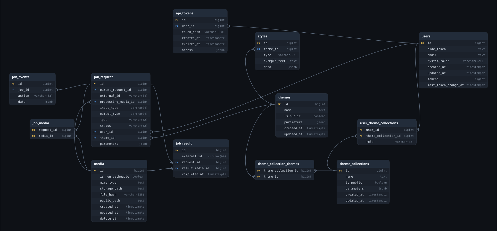

# ERD: модель данных

Схема БД диаграммой. Источник правды — Liquibase-чанжлог
`backend/api/src/main/resources/db/changelog/`: из него собираются и [`db.sql`](db.sql), и диаграмма ниже
(`make db-schema`, `make db-erd`). Руками файл не правим — меняем чанжлог.

Текстовый Mermaid-вариант доступен через `python3 .github/scripts/db_schema.py --mermaid`;
в опубликованной документации используется локально сгенерированный SVG.

## Связи

Внешние ключи в том виде, в каком они объявлены в схеме: `ребёнок.колонка` → `родитель.колонка`.

| Ребёнок | Колонка | Родитель | Колонка | Обязательная |
|---|---|---|---|---|
| `api_tokens` | `user_id` | `users` | `id` | да |
| `job_events` | `job_id` | `job_request` | `id` | да |
| `job_media` | `request_id` | `job_request` | `id` | да |
| `job_media` | `media_id` | `media` | `id` | да |
| `job_request` | `parent_request_id` | `job_request` | `id` | нет |
| `job_request` | `processing_media_id` | `media` | `id` | да |
| `job_request` | `user_id` | `users` | `id` | да |
| `job_request` | `theme_id` | `themes` | `id` | да |
| `job_result` | `request_id` | `job_request` | `id` | да |
| `job_result` | `result_media_id` | `media` | `id` | да |
| `styles` | `theme_id` | `themes` | `id` | да |
| `theme_collection_themes` | `theme_collection_id` | `theme_collections` | `id` | да |
| `theme_collection_themes` | `theme_id` | `themes` | `id` | да |
| `user_theme_collections` | `user_id` | `users` | `id` | да |
| `user_theme_collections` | `theme_collection_id` | `theme_collections` | `id` | да |
